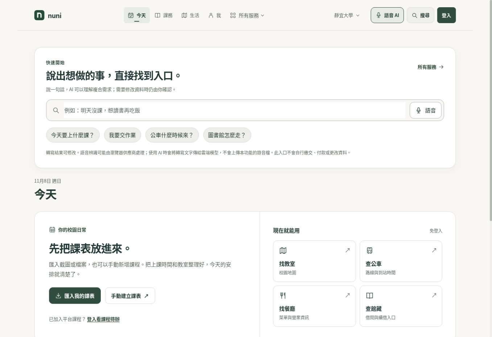
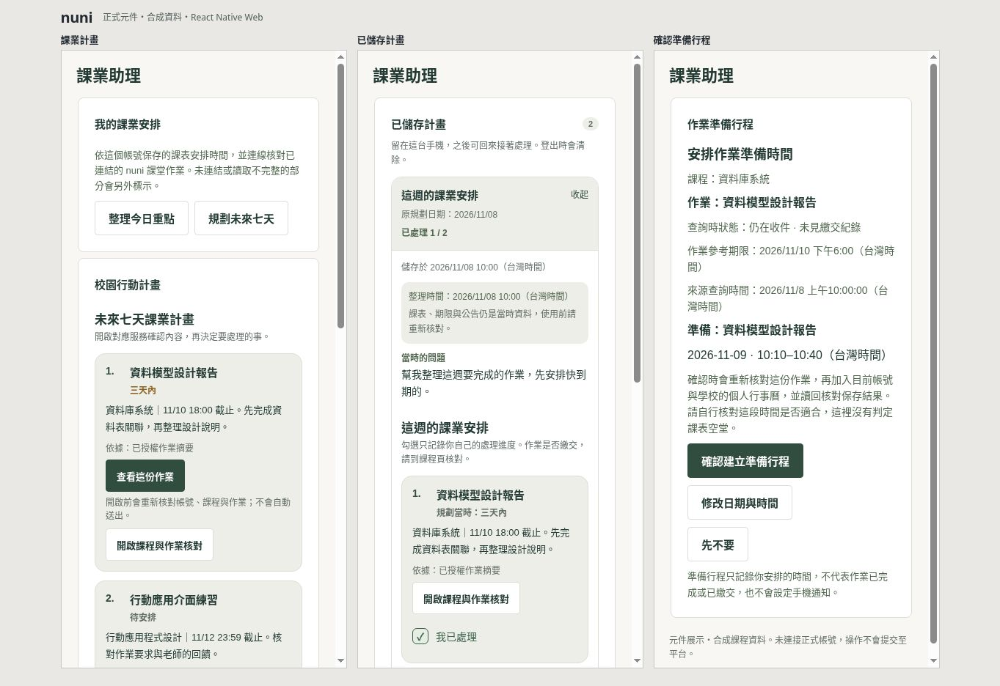

# nuni｜AI 校園助理

[](https://github.com/Miiduoa/graduation/actions/workflows/ci.yml)
[](https://github.com/Miiduoa/graduation/actions/workflows/codeql.yml)

**把課表、課業與校園服務串在一起，讓助理陪你把下一件事做完。**

nuni 提供 Web 與手機介面。學生可以請助理整理近期作業與測驗、保存讀書計畫、找準備時間，再確認建立個人行程；也能從同一個入口找到課程、圖書館、公車與校園生活服務。

[開啟 nuni](https://nuni.tw/) · [兩分鐘導覽](docs/REVIEW_IN_2_MINUTES.md) · [操作截圖](docs/SCREENSHOTS.md) · [文件目錄](docs/README.md)



_2026-11-08 擷取的 nuni.tw 公開訪客畫面。下方功能以本儲存庫 main 的實作為準；正式環境的開放範圍依畫面、帳號與校園而定。_

## 助理如何完成一件事

以「幫我安排這份作業的準備時間」為例，手機助理會接續同一份課業資料：

1. **讀取來源**：從目前帳號有權使用的課程，整理作業名稱、期限與本人繳交紀錄。
2. **找可用時段**：核對已儲存的課表及個人行程，提供三十分鐘的準備時段，或由使用者輸入時間。
3. **確認後執行**：使用者選定時段、看過完整預覽並確認後，重新核對原作業與行程衝突，再保存個人行程。
4. **讀回核對**：重新讀到相符紀錄才顯示成功，並提供查看行程與原作業的入口。連線或儲存結果不明時，保留原操作供核對。

已保存的讀書計畫可繼續勾選個人進度、比較新舊資料；從歷史計畫開始新的操作前，仍要重新取得目前來源。建立準備行程與繳交作業是兩個不同的結果，畫面會分別呈現。

| 助理能力           | 使用者可以做什麼                                           | 實作說明                                                                                                              |
| ------------------ | ---------------------------------------------------------- | --------------------------------------------------------------------------------------------------------------------- |
| 今日與七日課業計畫 | 整理課表、作業與測驗，從計畫開啟對應課業                   | [計畫接續作業](docs/assistant/2026-11-08-plan-coursework-execution.md)                                                |
| 作業準備時間       | 找三十分鐘候選、選擇時段、預覽後確認建立                   | [尋找空堂與執行](docs/assistant/2026-11-08-coursework-free-time-execution.md)                                         |
| 連續追問空堂       | 調整今天、明天或後天，以及鐘點與最低時長；每輪重讀已存課表 | [空堂條件追問](docs/evidence/agent-class-gap-followups/README.md)                                                     |
| 個人行程執行       | 核對後保存，處理部分成功與待確認結果                       | [執行與回執](docs/assistant/2026-11-07-verified-execution.md)                                                         |
| 任務續接           | 保存計畫、核對來源變動，重新開啟 App 後查核已嘗試的行程    | [保存計畫](docs/evidence/agent-saved-plans/README.md) · [手機恢復](docs/assistant/2026-11-08-mobile-task-recovery.md) |
| 課業紀錄查詢       | 查看確切作業、測驗與本人紀錄，接續原課程頁                 | [手機操作路徑](apps/mobile/DEMO.md)                                                                                   |
| 校園服務接續       | 依目前帳號與校園找到服務，使用可用的原生頁或網站入口       | [共用服務目錄](docs/assistant/2026-11-07-service-connections.md)                                                      |

手機的個人行程保存於目前帳號、校園所屬的裝置資料；Web 的確認執行另依平台 API 與功能設定啟用。服務目錄中的 43 個識別項目代表接通的入口，不代表每項都能直接代辦或已在各校開放。

## 操作畫面



_手機畫面為 main 正式元件的 React Native Web 展示，使用合成資料；不是 iOS／Android 實機截圖。完整圖片、資料來源與重拍方式見 [截圖說明](docs/SCREENSHOTS.md)。_

## 課業與校園生活

| 範圍           | 目前程式提供的操作                                               | 使用條件                                           |
| -------------- | ---------------------------------------------------------------- | -------------------------------------------------- |
| 課表與個人資料 | 手動建立課表，從截圖、文字或檔案整理課表、成績與行程，匯入前核對 | 資料依裝置、帳號與校園區分；匯入紀錄不等同校方認證 |
| 課程與作業     | 閱讀教材、繳交作業、回答測驗、查看收件與教師回饋                 | nuni 平台登入及該課程的有效成員資格                |
| 教師課程工作   | 發布內容、查看學生收件、留下教師回饋                             | 由各課程的後端授權決定                             |
| 校園資訊       | 地圖、公車、公告、圖書館、餐廳與學校資訊入口                     | 公開資訊可先瀏覽；即時資料取決於各校來源及服務設定 |
| 生活安排       | 個人行事曆、宿舍備忘、設備問題紀錄、入住退宿清單與洗衣計時       | 部分內容保存在本裝置；宿舍備忘不等同向校方送出申請 |
| 交流與訊息     | 公開看板、校內交流、通知與對話                                   | 平台與校園服務使用各自的帳號及資料權限             |
| 店家與平台管理 | 店家進駐申請、本人門市狀態，及有授權者的管理工作區               | 申請、核准、營業與線上收款各自確認                 |

### 帳號與學校

- **公開瀏覽**：先選擇想看的校園，使用已提供公開來源的服務。
- **nuni 平台帳號**：透過 Google 登入使用平台課程與已開放的個人服務；課程角色由後端確認。
- **學校連線**：校方課表、成績與外部 LMS 另依該校整合與授權提供。選擇校園不會自動取得校籍或私人資料。

帳號流程與兩端差異見 [帳號、學校資格與店家進駐](docs/ACCOUNT_AND_SCHOOL_ACCESS.md)。TronClass／玩課雲資料與 nuni 平台課程分別處理，原校方作業仍依原系統的繳交流程。

## 本機開發

使用 [.nvmrc](.nvmrc) 指定的 **Node.js 22.23.4** 與 [package.json](package.json) 指定的 **pnpm 10.28.2**。以下以 nvm 管理 Node 的環境為例；若使用其他方式，先安裝相同 Node 版本：

```bash
git clone https://github.com/Miiduoa/graduation.git
cd graduation
nvm install
nvm use
corepack enable
corepack prepare pnpm@10.28.2 --activate
pnpm install --frozen-lockfile
```

設定對應的開發環境後啟動：

```bash
pnpm dev:web       # Next.js Web
pnpm dev:mobile    # Expo 開發伺服器
pnpm ios:sim       # macOS + Xcode，建置並啟動 iOS 模擬器
```

完整設定、公開設定與伺服器憑證的區別見 [新機器設定](docs/SETUP_NEW_MACHINE.md)；Web 的環境範本與登入設定見 [Web 開發說明](apps/web/README.md)。原生登入與其他原生模組需要相符的開發版本，不以 Expo Go 代表完整 App。

### 專案結構

| 目錄                                   | 內容                                                                  |
| -------------------------------------- | --------------------------------------------------------------------- |
| [`apps/mobile/`](apps/mobile/)         | Expo 54、React Native 0.81、React Navigation；手機介面與裝置能力      |
| [`apps/web/`](apps/web/)               | Next.js 16、React 19、TypeScript；網站與同源 API 層                   |
| [`packages/shared/`](packages/shared/) | 跨端型別、課業與服務契約、匯入及執行規則                              |
| [`deploy/nuni-api/`](deploy/nuni-api/) | nuni API 的固定來源、修補與重建流程                                   |
| [`backend/`](backend/)                 | Firebase Functions、Firestore／Storage 規則、模擬器測試與選用 AI 服務 |
| [`docs/`](docs/README.md)              | 操作、架構、驗證、發布及歷史紀錄                                      |

[架構總覽](docs/ARCHITECTURE_OVERVIEW.md) 說明 nuni 平台 API、Firebase 校園服務與各端資料如何分工。不同後端的身分不會因為同名帳號而自動互通。

## 驗證與發布

```bash
pnpm lint
pnpm typecheck
pnpm format:check
pnpm --filter web test
pnpm --filter mobile test
pnpm test:rules
```

Web 使用 Vitest，手機使用 Jest；`test:rules` 需要 Java 21 與 Firebase emulators。原生導覽另有 [Maestro E2E](.github/workflows/maestro-e2e.yml)，助理流程另有 [Mobile Agent Regression](.github/workflows/mobile-agent-regression.yml)。

新提交以 [GitHub Actions](https://github.com/Miiduoa/graduation/actions) 的實際結果為準。main、線上 Web／API 與商店版本分開追蹤；尚未合併的 PR 不列為 main 已完成的能力。

- [測試證據](docs/TESTING_EVIDENCE.md)：依提交與執行紀錄判讀，保留未驗證範圍。
- [歷次平台發布](docs/PLATFORM_RELEASE.md) · [原生發布](docs/STORE_RELEASE.md)：每份紀錄只代表該日期與版本。
- [安全說明](docs/SECURITY.md) · [依賴風險](docs/DEPENDENCY_RISK_REGISTER.md)：權限與仍需處理的風險。
- [開發中的 PR](https://github.com/Miiduoa/graduation/pulls)：功能進度與待合併修改。

## 專題團隊

靜宜大學資訊管理學系：楊世堅、周攸晨、顧晉瑋、吳容陞。

儲存庫維護：[顧晉瑋／Miiduoa](https://github.com/Miiduoa)

本專案舊名 Campus One。歷史文件、套件名稱與既有路徑可能保留舊名稱，對外產品名稱統一使用 **nuni**。
