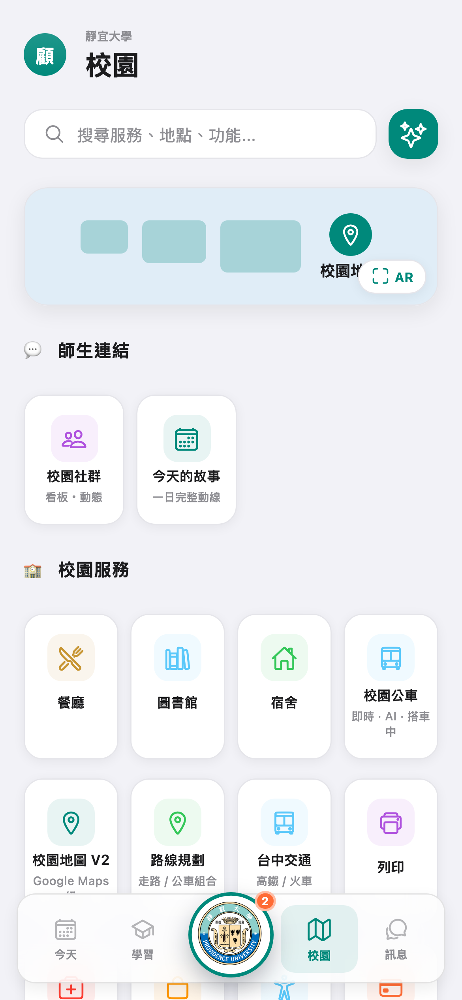

# Campus One｜課程與校園生活

[](https://github.com/Miiduoa/graduation/actions/workflows/ci.yml)

Campus One 將課程待辦、教材、作業、測驗和校園服務放在同一個入口。學生從待辦回到課程完成繳交，老師查看實際收件並留下回饋。Web 與 App 共用帳號契約及部分商業規則。

目前持續開發中。平台課程使用 Nuni 帳號與 API；學校課表、成績及部分校園服務仍使用各自的校務連線與 Firebase。多校瀏覽不代表已取得校籍或校方授權。正式服務、示範流程和未完成項目見 [全功能驗收表](docs/PRODUCT_ACCEPTANCE_2026-10-11.md)。

[兩分鐘導覽](docs/REVIEW_IN_2_MINUTES.md) · [架構說明](docs/ARCHITECTURE_OVERVIEW.md) · [測試紀錄](docs/TESTING_EVIDENCE.md) · [作品介紹](https://miiduoa.github.io/case-studies/campus-one/)

## 日常操作

- **學生**：今日待辦 → 對應作業或測驗 → 送出 → 確認回執；在課程內查看老師回饋。
- **老師**：授課課程 → 發布內容 → 查看收件 → 留下回饋。課程角色與學校職務分開驗證。
- **校園服務**：以「繳交 作業」「借書」「公車」等需求搜尋，確認所需帳號後進入。
- **店家與管理員**：店家合作查看進駐申請；管理員入口處理學校接入與跨校檢舉，權限由伺服器確認。

Web 服務入口：[nuni.tw](https://nuni.tw/)。線上版本以 [發布紀錄](docs/PLATFORM_RELEASE.md) 為準，尚未合併的修改不等於已上線。

公開校園資訊可以直接瀏覽。需要加入課程、繳交作業或申請店家時，再使用 Campus One 平台帳號；個人課表與成績另需已開放的學校連線。瀏覽校園、平台登入或提交學校資格申請，都不會自動授予校籍、教師或管理員權限。

## Mobile 畫面

<p>
  
</p>

既有原型畫面：學生端校園服務入口。

更多操作流程見 [Mobile demo](apps/mobile/DEMO.md)。

## 功能與程式入口

- **Mobile**：今天、課務、生活、我。課表、作業、訊息、校園地圖與公車。使用 Expo 54、React Native 0.81、React Navigation，程式位於 [`apps/mobile/`](apps/mobile/)。
- **Web**：學生與管理／教學介面，使用 Next.js 16、React 19、TypeScript，程式位於 [`apps/web/`](apps/web/)。
- **Backend**：Nuni API 的可重建來源與修補位於 [`deploy/nuni-api/`](deploy/nuni-api/)；Firebase Functions、Firestore／Storage 規則與測試位於 [`backend/`](backend/)。
- **Shared**：跨端共用的型別與規則位於 [`packages/`](packages/)，由 pnpm workspace 管理。

## 本機執行

需求：Node.js 22、pnpm 10。Node.js 22 是 CI／Expo 工具鏈基準；根目錄的 engines 也保留 Node 20.19.4+、低於 21 的相容範圍。

```bash
git clone https://github.com/Miiduoa/graduation.git
cd graduation
pnpm install
```

Web：

```bash
pnpm dev:web
```

Mobile：

```bash
pnpm dev:mobile
```

iOS simulator：

```bash
pnpm ios:sim
```

外部服務的可用範圍取決於環境與憑證設定；部分資料及角色流程以 demo data 展示。

## 資料與權限

### 跨端與角色權限

共用型別與規則集中在 workspace package；平台 UI、導航與裝置能力留在各端。權限檢查涵蓋路由、UI、資料存取、後端授權及 Firestore／Storage 規則。

相關文件：[角色與資料流](docs/APP_ROLE_DATA_FLOW_ARCHITECTURE.md) · [跨角色資料流](docs/CROSS_ROLE_DATA_FLOW.md) · [API](docs/API.md) · [設計決策紀錄](docs/adr/README.md)

### 安全導頁與服務失效處理

Deep link、通知與訊息 action 經過 route registry 及 safe navigation。部分流程提供 mock、cache 或 hybrid data path，讓外部服務失敗時仍能辨識資料狀態、保留基本導航。

### 成績通知的收件人檢查

舊版教師評分頁是本機示範，不會寫入 TronClass 成績；與 Nuni 課程空間的作業收件與回饋流程分開。發布本機成績事件前，會檢查教師帳號及教學角色、明確的學生 UID、作業 ID 與分數；不以姓名或學號推測收件人。

- [評分頁](apps/mobile/src/screens/TeacherGradingScreen.tsx)
- [傳送前檢查](apps/mobile/src/services/prepareGradingDelivery.ts)
- [收件人隔離測試](apps/mobile/src/__tests__/prepareGradingDelivery.test.ts)

### 課表與安排

個人課表用靜宜第 1–13 節。截圖或學校選課紀錄要確認後才寫入。好友課表要先加好友才看得到。共同空堂可以約吃飯或讀書。「幫我安排」是依課表算出下一堂、空堂與讀書時段，不是另外一套對話服務。

## 驗證

根目錄提供：

```bash
pnpm lint
pnpm typecheck
pnpm format:check
pnpm test:rules
```

Mobile 使用 Jest，Web 使用 Vitest，原生 UI 流程另有 Maestro E2E workflow。`test:rules` 會啟動 Firebase emulators，需要對應的 Java 環境。

[測試紀錄](docs/TESTING_EVIDENCE.md) 按 CI run 與 commit 記錄結果；[依賴風險清單](docs/DEPENDENCY_RISK_REGISTER.md) 保留尚待處理的風險。主要 CI 成功不代表原生 Maestro E2E 已通過、所有裝置都可安裝，或所有安全警示都已清除。

一般 CI 只驗證 Expo Doctor、公開 app config 與 `eas.json` build profile，不需要 `EXPO_TOKEN`，也不提交 EAS Cloud build。iOS／Android 雲端建置由手動的 `EAS Build`／`Release` workflow 執行，屆時才需要 Expo 帳號憑證。

[查看 GitHub Actions](https://github.com/Miiduoa/graduation/actions)

## 目前限制

- 這是校園產品原型，尚非正式校務系統；demo data 不代表校方權威資料。
- 外部 LMS、地圖、即時交通需要相應環境及憑證。沒開通的服務會在畫面上直接說明。
- Repo 同時保留研究、驗證及口試文件；待修問題見 [REMAINING_BUGS_AUDIT](docs/REMAINING_BUGS_AUDIT.md)。
- 點名的伺服器確認要求及現有限制，另見 [Attendance verification boundary](docs/ATTENDANCE_VERIFICATION.md)。

## 作者

顧晉瑋 · Providence University, Information Management  
[GitHub / Miiduoa](https://github.com/Miiduoa)
