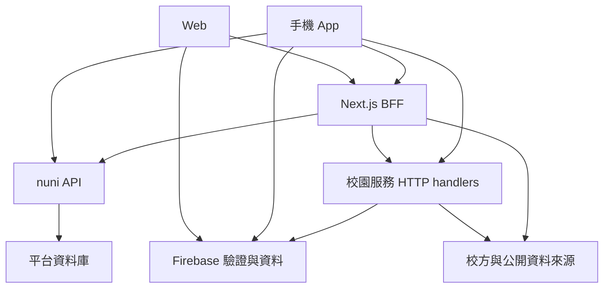

# nuni 架構說明

nuni 由 Web、原生 App、平台 API 與校園服務組成。課程與平台帳號走 nuni API，既有校園帳號與部分服務仍使用 Firebase；個人匯入資料及行程另有裝置端儲存。AI 助理透過這些既有資料與操作能力完成任務。

以下是程式責任與資料邊界。各功能是否在正式環境啟用，需另外對照 [發布紀錄](PLATFORM_RELEASE.md) 與該版本的驗收。

## 程式放在哪裡

| 位置                                                                                   | 責任                                                             |
| -------------------------------------------------------------------------------------- | ---------------------------------------------------------------- |
| [`apps/web`](../apps/web/README.md)                                                    | Next.js 16／React 19 頁面、PWA、同源 BFF、平台助理               |
| [`apps/mobile`](../apps/mobile/)                                                       | Expo 54／React Native 0.81 App、原生能力、手機助理與裝置資料     |
| [`packages/shared`](../packages/shared/)                                               | 跨端型別、課程與校園識別、匯入解析、服務目錄、行程收據與同步契約 |
| [`deploy/nuni-api`](../deploy/nuni-api/README.md)                                      | 固定來源版本、修補與雜湊核對，重建 nuni API 的候選映像           |
| [`backend/functions`](../backend/functions/)                                           | 校園服務 handlers、授權、交易與相關測試                          |
| [`deploy/functions-server`](../deploy/functions-server/)                               | 讓既有 Firebase handlers 以 HTTP 服務執行的 host                 |
| [`backend/firestore`](../backend/firestore/)、[`backend/storage`](../backend/storage/) | 用戶端 Firestore／Storage 存取規則                               |
| [`backend/ai-server`](../backend/ai-server/)                                           | 選用的 Python AI、RAG 與本機模型實驗                             |
| [`supabase`](../supabase/)                                                             | 既有 LMS v2 的 schema、functions 與遷移資料                      |

部署目錄保留來源與重建程序；不能把其中任一候選映像當成已包含所有 main 修改的正式後端。

## 主要服務路徑

Web 的 nuni 操作先經 BFF，平台 session 存在加密的 HttpOnly Cookie；BFF 驗證來源與 session 後才呼叫平台 API。手機將平台 session 存在可用的原生安全儲存，透過固定 API transport 取得平台資料，部分能力另經 Web BFF。

Firebase 校園資料是獨立路徑。用戶端直接存取由 Firestore／Storage 規則限制；使用 Admin SDK 的伺服器 handler 必須自行驗證身分、角色與資料範圍，不能用前端按鈕或用戶端規則取代伺服器授權。

關鍵入口：[Web BFF](../apps/web/src/lib/nuni/server.ts) · [Mobile transport](../apps/mobile/src/services/nuniClient.ts) · [Mobile session](../apps/mobile/src/state/nuniSession.tsx) · [校園服務 HTTP host](deploy/functions-on-fly.md)

## 帳號、學校與角色

| 範圍           | 來源與意義                                                      |
| -------------- | --------------------------------------------------------------- |
| 瀏覽學校       | 決定目前查看哪一校的公開服務；不授予私人資料權限                |
| nuni 平台帳號  | Google 等已開放 provider 的平台 session，用於課程空間及平台服務 |
| 課班身分       | 該 workspace 的學生、授課者與成員關係，由課程 API 判定          |
| 校園身分       | 另經學校連線及 Firebase 驗證，才能存取已開通的本人校務          |
| 店家／行政權限 | 依門市指派、角色與後端權限決定，不能自行註冊成管理員            |

平台登入不會自動建立校籍；一門課的老師也不會因此取得學校行政權限。帳號、session 或所選學校改變時，私人請求與晚到回應須重新核對範圍。

Mobile 的校園登入導覽目前為「今天／課務／生活／訊息／我」，店家角色第二個入口顯示「店家」。各角色差異主要在入口內的內容與授權。平台／訪客流程使用獨立導覽，經 [SchoolSessionBoundary](../apps/mobile/src/app/SchoolSessionBoundary.tsx) 判斷是否進入私人校園介面；不能把校園登入畫面當成所有使用者的首頁。

導覽依據：[App.tsx](../apps/mobile/App.tsx) · [角色入口](../apps/mobile/src/services/permissions.ts) · [訊息分頁](../apps/mobile/src/app/tabsWithMessages.ts)。詳細規則見 [帳號與校園存取](ACCOUNT_AND_SCHOOL_ACCESS.md)、[角色資料流](APP_ROLE_DATA_FLOW_ARCHITECTURE.md) 與 [跨角色資料流](CROSS_ROLE_DATA_FLOW.md)。

## AI 助理如何完成任務

助理先取得目前帳號、校園與題目所需的資料，再選擇可用工具。服務目錄負責找到正確入口；來源查詢負責提供可核對的內容；執行器負責需要確認的操作。入口數量不代表可自動完成的交易種類。

| 能力           | 目前責任與邊界                                                                                     |
| -------------- | -------------------------------------------------------------------------------------------------- |
| 課表與課業查詢 | 讀取本人已保存或已同步的課表，依明確課程連結查作業／測驗；標示未連結或讀取不完整的部分             |
| 計畫與服務導覽 | 整理今日／未來七天安排，開啟具體課程、作業、測驗與校園服務；保存計畫與勾選進度不會改變校方提交狀態 |
| 個人行程執行   | 顯示明確預覽，取得確認，寫入既有資料層，再讀回相同事件才顯示成功                                   |
| 不明結果與恢復 | 保留原操作 ID，重新讀取核對；不能因逾時另建一筆，已完成項目不因後一筆失敗而消失                    |
| 手機多筆行程   | 一批 2–4 筆明確行程，逐筆執行；未核對結果時停止後續，再次確認才接續                                |
| 點餐與其他業務 | 依實際開通能力準備內容或交接服務頁；導頁、備單與模型文字不構成訂單、付款或繳交收據                 |

Web v2 的模型與工具在 Node BFF 執行，保留來源授權、同源檢查、外送同意、呼叫預算、確認卡與寫入開關。手機已有不依賴模型的課業與明確行程流程；雲端對話、本機模型與 Python 實驗仍各有自己的設定，不是所有任務都經過同一個模型。

目前 Web 行程寫入使用平台 personal-imports 資料層，核對後再更新該裝置副本；手機行程執行使用本機個人資料層。這些操作不代表已同步 Apple／Google 行事曆、排程通知，或完成原作業。

程式與契約：[服務目錄](../packages/shared/src/assistantServices.ts) · [執行收據](../packages/shared/src/assistantExecution.ts) · [Web v2](../apps/web/src/lib/nuni/assistantV2.README.md) · [手機行程執行器](../apps/mobile/src/services/assistantCalendarExecution.ts)。流程說明見 [讀回核對](assistant/2026-11-07-verified-execution.md)、[手機重開恢復](assistant/2026-11-08-mobile-task-recovery.md)、[多筆行程](assistant/2026-11-08-mobile-batch-execution.md)。

## 裝置資料與失敗處理

個人匯入資料依擁有者與學校隔離。裝置副本、同步版本與待核對操作各自保留來源；本機有資料不表示雲端助理已讀取到相同內容。切換帳號不能借用另一個帳號的課表、成績或先前授權。

Web 的待核對行程紀錄存於同分頁 `sessionStorage`，手機另有持久化操作紀錄；恢復只授權讀回核對，未執行的後續步驟仍需使用者確認。清除裝置資料、換機或移除 App 的恢復能力不能由這些紀錄推論。

校園 DataSource 支援 mock、Firebase、hybrid 與快取，正式資料模式會限制模擬回退。服務失效時應保留來源、時間與錯誤狀態；模擬資料可以展示介面，不能當成校方資料或交易成功證據。

相關來源：[Mobile 資料政策](../apps/mobile/src/config/runtime.ts) · [Web 個人資料](../apps/web/src/lib/personalImports.ts) · [手機個人資料](../apps/mobile/src/services/personalImports.ts) · [Web 待核對紀錄](../apps/web/src/lib/assistantExecutionJournal.ts) · [手機操作紀錄](../apps/mobile/src/services/assistantCalendarJournal.ts)

## 驗證與發布

| 驗證                                                                        | 用途                                                                              |
| --------------------------------------------------------------------------- | --------------------------------------------------------------------------------- |
| [CI](../.github/workflows/ci.yml)                                           | 依賴與秘密掃描、型別／lint、Web／Mobile／Functions 測試、授權規則、助理整合與建置 |
| [CodeQL](../.github/workflows/codeql.yml)                                   | 程式安全分析                                                                      |
| [Mobile Agent Regression](../.github/workflows/mobile-agent-regression.yml) | 手機助理的指定任務回歸                                                            |
| [Maestro](../.github/workflows/maestro-e2e.yml)                             | 原生 UI 流程驗證                                                                  |
| [測試證據](TESTING_EVIDENCE.md)                                             | 各版本的執行紀錄、結果與限制                                                      |

測試結果應對應精確 commit、資料來源與裝置範圍。單元測試、瀏覽器展示、原生模擬器、真機與正式服務是不同的證據；發布時需核對該次修改的必要檢查及審查。

進一步閱讀：[設計決策紀錄](adr/README.md) · [API 說明](API.md) · [依賴風險](DEPENDENCY_RISK_REGISTER.md) · [Web 發布](WEB_RELEASE.md) · [App 發布](STORE_RELEASE.md)
