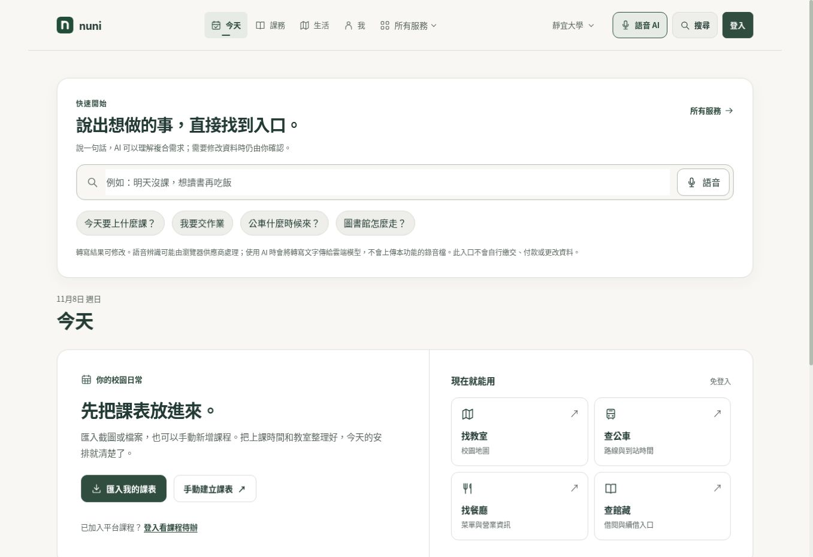
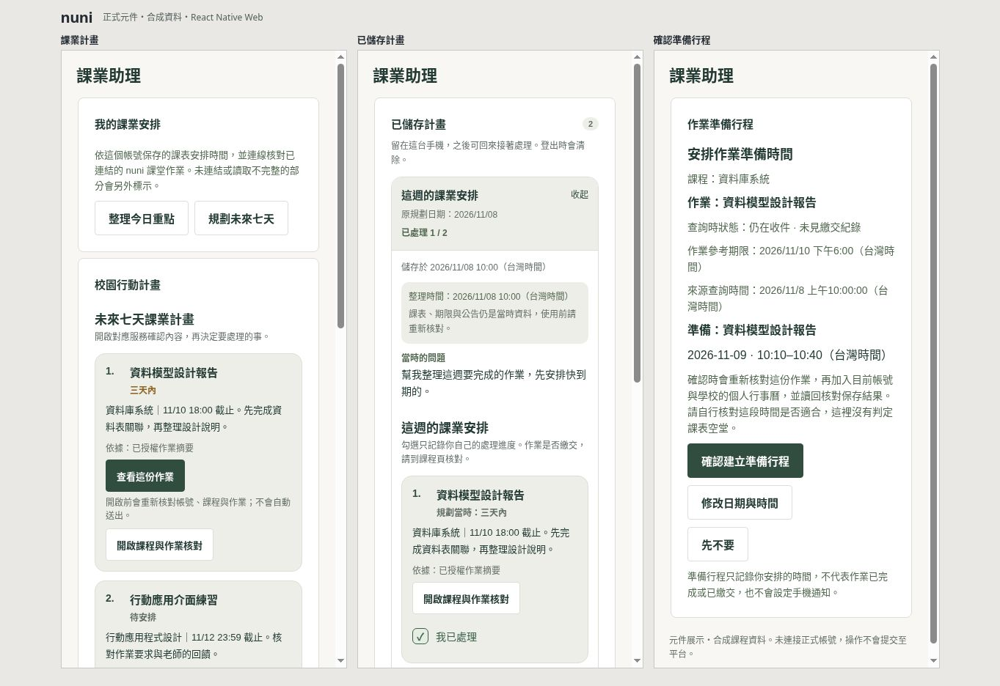
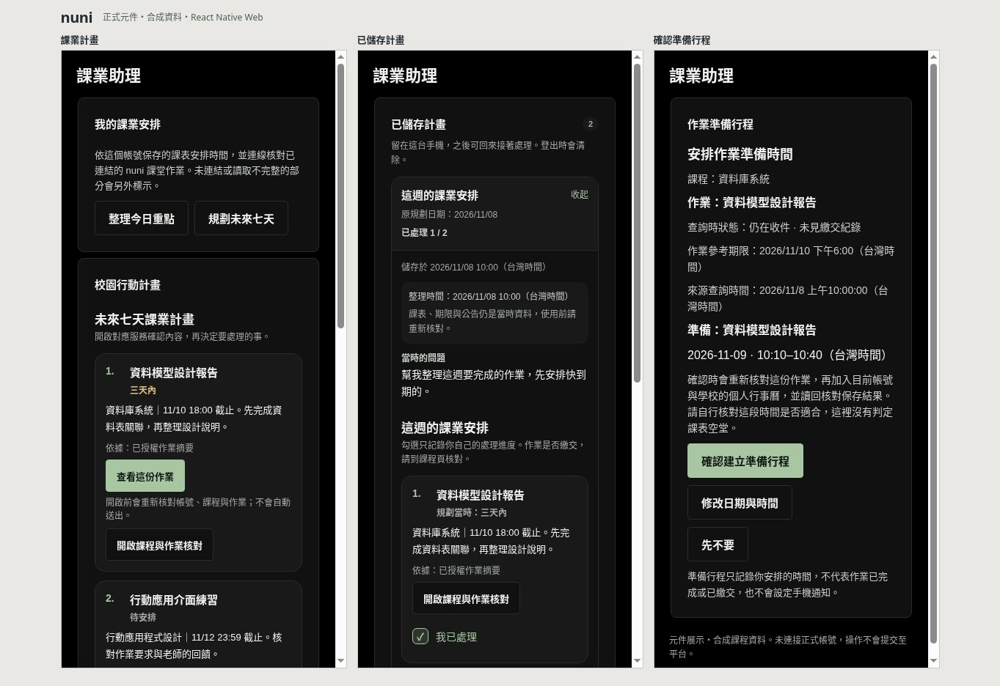
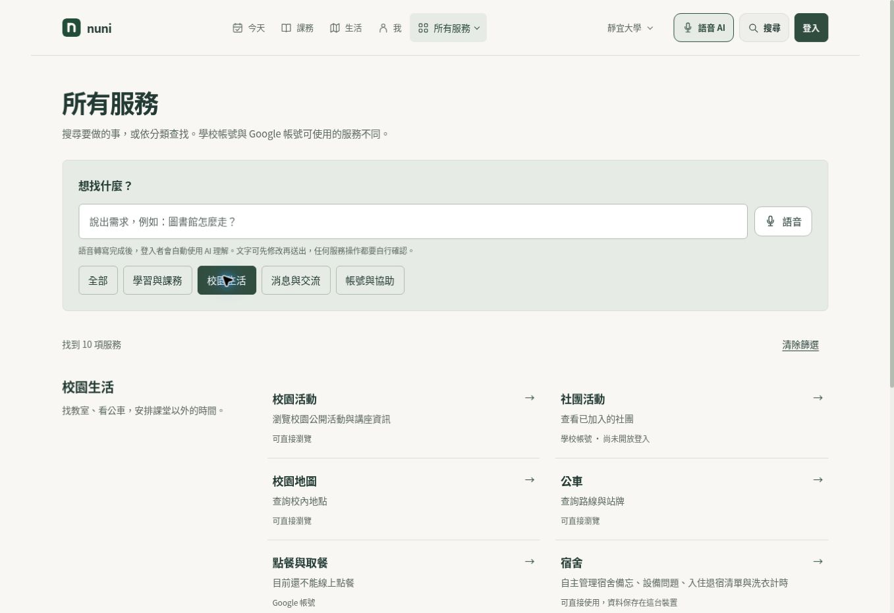
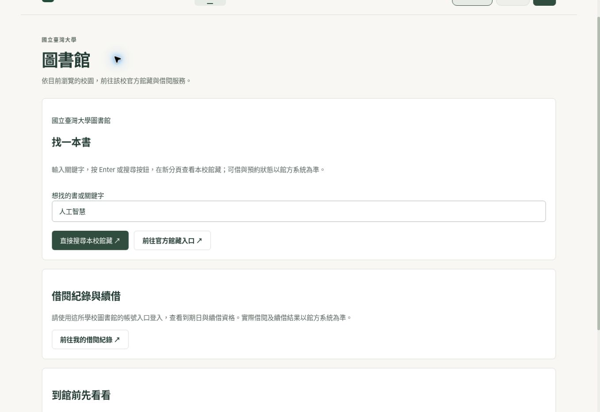

# nuni 操作截圖

這一組圖片在 **2026-11-08（台灣時間）** 擷取，取代專案首頁原先的舊版 Mobile 原型圖。公開網站直接截取當時頁面；手機助理用目前 main 的正式元件搭配合成課程資料展示，兩者分開標示。

[專案首頁](../README.md) · [兩分鐘導覽](REVIEW_IN_2_MINUTES.md) · [手機展示流程](../apps/mobile/DEMO.md)

## 今天：從需求與課表開始



來源：<https://nuni.tw/>。未登入的公開頁面，顯示當時選定的靜宜大學，以及課表匯入、地圖、公車、餐廳和圖書館入口。未載入真實學生的課表或作業。

## 助理：計畫、續接與確認



由左至右是課業計畫、已儲存計畫及準備行程確認。三個展示框直接掛載 `CampusEvidencePlanCard`、`SavedCampusPlansPanel`、`NuniCourseworkStudyAction` 等正式元件，保留元件原有文字、按鈕、樣式及捲動行為。

資料採虛構課程與作業，範例時鐘固定在 2026-11-08 10:00（台灣時間）。右側使用手動指定的 11/9 10:10–10:40 時段，畫面會說明尚未判定課表空堂；沒有把它包裝成自動找到時段或已完成寫入。

這是 React Native Web 的元件展示，不是 iPhone／Android 實機。展示不登入、不連線取得課程，也不送出平台操作；只能用來確認這些元件的實際版面。原生安全區設為零，Ionicons 沿用既有 QA 的空元件，裝置儲存使用記憶體替身。

### 深色外觀



沿用相同資料與正式元件，僅切換專案已有的深色主題。明暗兩張都是直接擷取瀏覽器畫面。

## 服務目錄：按需求查找



來源：<https://nuni.tw/search?schoolId=pu&campus=pu&school=PU&category=campus>。畫面保留當時的服務開放與帳號條件，目錄中出現一個入口不等同已完成該服務的登入、下單或申請。

## 跨校圖書館：切換公開資料來源



來源：<https://nuni.tw/library?schoolId=ntu&campus=ntu&school=NTU>。實際透過校園選單切換後，圖書館名稱及館藏／借閱連結改為臺大的來源。畫面中的「人工智慧」是示範查詢文字，未登入館方帳號，未查詢私人借閱紀錄。

## 來源與版本

| 項目         | 記錄方式                                                                                                                                    |
| ------------ | ------------------------------------------------------------------------------------------------------------------------------------------- |
| 公開網站     | 擷取當時的 `nuni.tw` 畫面。未取得部署 SHA，因此不假設網站與當天 main 完全一致                                                               |
| 助理元件     | 應用程式來源為 [`040957b6`](https://github.com/Miiduoa/graduation/commit/040957b6b36f41c9f5558c1b8bbc61d3a9a5a7f7)，包含已合併的 #523、#537 |
| 展示資料     | 本次新增的 [fixture.tsx](../scripts/docs-preview/fixture.tsx)，不含真實姓名、學號、課程帳號或私密憑證                                       |
| 畫面產出     | 瀏覽器直接擷取；未用生成圖片重畫介面，也未修改截圖中的文字或狀態                                                                            |
| 逐張資訊     | [manifest.json](screenshots/2026-11/manifest.json) 記錄尺寸、檔案雜湊、來源與擷取時間                                                       |
| 元件建置來源 | [component-source.json](screenshots/2026-11/component-source.json) 記錄程式來源雜湊、套件版本與替身範圍                                     |

圖片只能支持實際拍到的畫面。任務是否真正完成，仍須查核原服務回執與對應提交的測試；完整流程見 [行程執行與核對](assistant/2026-11-07-verified-execution.md)。

## 如何更新這組圖片

安裝專案依賴後，在 repository 根目錄執行：

```bash
node scripts/docs-preview/build.mjs
```

輸出在 `artifacts/docs-preview/`，開啟該目錄的本機 HTTP 預覽後，由 `index.html` 選擇並列展示或個別畫面。建置腳本不會啟動伺服器、不會登入正式帳號，也不會自動發布頁面。

可用頁面及資料替身見 [展示建置說明](../scripts/docs-preview/README.md)。重拍時保留合成資料標示，更新圖片與 manifest；若改成原生實機或有登入的展示，另外記錄裝置、App build 與資料來源。

舊的 `docs/mobile-screenshots/`、`docs/demo-screenshots/` 與各 `docs/evidence/` 圖片保留作原版本的開發證據，不以本次日期重新標示。
