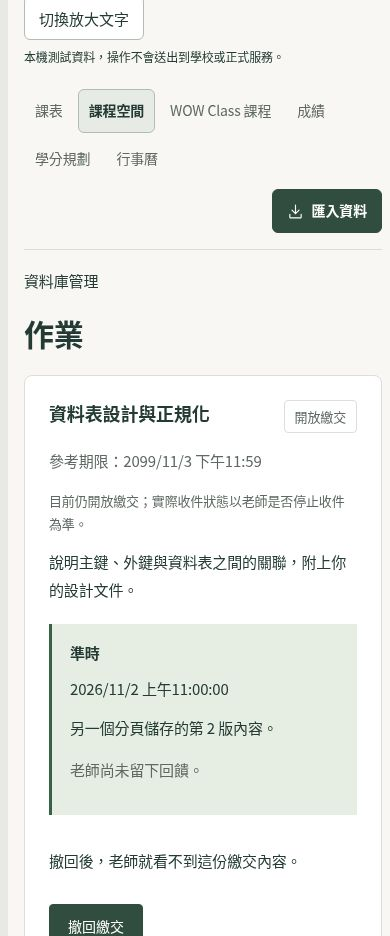
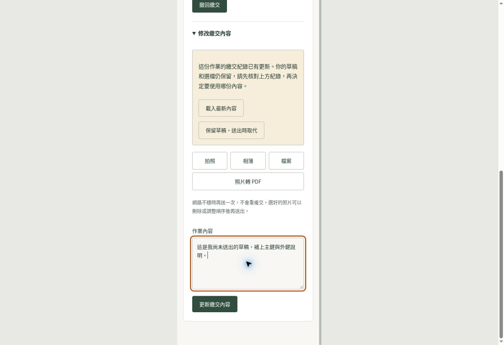

# 課務入口、登入恢復與作業草稿驗證

日期：2026-11-02（Asia/Taipei）。本紀錄對應本次課務修正，遠端檢查以 PR 的實際提交為準。

## 問題與修正

### 課程入口

主要「課務」入口原本通往課表，而共用課務導覽沒有 `/classroom`。加入固定「課程空間」連結，並在課程首頁與詳細頁標示目前位置。學校 LMS 讀取停用時仍能進入平台課程；登入、帳號頁不誤套課程分頁。

### App 登入狀態

啟動時同時讀取 Keychain，原本會在資料回來前把狀態標成已載入，其他讀取因此誤判沒有連線。現在共用載入 Promise，並以工作階段版本隔離遲到的讀取、遷移、資料回應及重新登入結果。儲存操作依序執行，登出或新登入不會被較早的寫入覆蓋。

另外保留安全儲存失敗時的舊副本，允許暫時讀取失敗後重試；新 session 沒有有效 userId 時先留空。過期重新登入及 profile 的成功、HTTP 失敗、網路拒絕、讀取回應失敗，都不得清除新 session 或另啟 CAS 登入。

### 學生作業草稿

未編輯的內容跟隨最新回執；已有文字或選檔時，其他分頁的新繳交會保留草稿，要求選擇「載入最新內容」或「保留草稿，送出時取代」。老師回饋與下載簽章更新不會打斷編輯。送出不確定時繼續確認原內容與同一 idempotency key；晚到回應不把較新的繳交紀錄倒退。

這是對畫面已觀察版本的保護，沒有新增後端 expected-version／CAS 契約。尚未同步到畫面的真正同時寫入，仍需後續的伺服器版本契約處理。

### 照片預覽

照片 URL 由持有選檔的作業元件管理：刪除、清空或真正離頁才釋放，排序與暫時停止收件不釋放。Strict Mode 重跑 effect 不會破壞預覽。移除照片後，舊放大視窗不會隨新選檔再次出現。

## 自動化驗證

- Node.js 22.23.4、pnpm 10.28.2，依原鎖定檔安裝，沒有更新套件。
- Mobile TronClass：5 個套件、66 項測試通過，其中新增工作階段案例 25 項。
- 完整 Web Vitest：427 個測試檔通過、6 個略過；8,946 項通過、36 項略過。此結果涵蓋本批全部 Web 修改，略過項目不計為通過。
- Web 與 Mobile TypeScript 檢查通過。
- 修改的 Web 檔案 ESLint 無錯誤與警告；Mobile client 保留 11 項既有警告，沒有新增 lint error。
- Web 正式模式建置通過。首次本機建置因沙箱禁止 Next.js 寫入工具設定而失敗；停用遙測並允許建置程序正常執行後完成，未修改專案建置設定。
- `git diff --check` 通過。

基底重現使用 `007b48e0f29c0aa842c60cdea4826f3e62a2f211`：原始 Mobile client 的 Git blob 為 `dc1cccb4178ee19528c16db1d0c3116302c63f1d`，最初 14 項 session 測試在原碼全部出現行為失敗。refresh 與網路拒絕案例也先重現再修正。作業草稿最初 5 項案例在原碼失敗，另重現晚到回執導致父層倒退的情境。

主要重跑命令：

```bash
pnpm --filter mobile exec jest \
  src/__tests__/services/tronClassSessionRestore.test.ts \
  src/__tests__/services/tronClassConnection.test.ts \
  src/__tests__/services/tronClassSecurity.test.ts \
  src/__tests__/services/tronClassDataEnabled.test.ts \
  src/__tests__/services/tronClassOwnedCourses.test.ts --runInBand

pnpm --filter web exec vitest run \
  src/features/nuni/AssignmentCard.drafts.test.tsx \
  src/features/nuni/AssignmentCard.test.tsx \
  src/features/nuni/CourseAssignments.test.tsx \
  src/features/nuni/AssignmentFileFields.test.ts \
  src/features/nuni/AssignmentFilePicker.test.tsx \
  src/components/academic/AcademicNavigation.test.tsx \
  src/app/school-lms/gate.test.tsx \
  src/features/nuni/NuniApp.test.tsx --maxWorkers=2
```

## 瀏覽器檢查

使用真實 React 元件、CSS module 與全域主題，帳號、導覽及傳輸介面替換成隔離測試資料；沒有連線學校或正式服務。以 Chromium 的 320px／390px iframe viewport 檢查導覽重排、草稿衝突、採用新版及焦點返回；另檢查 320px 的深色模式與 200% 根字級。





以上是瀏覽器元件流程，不能當成真機 Keychain、Safari、螢幕閱讀器、學校帳號或正式後端端到端驗收。

## 發布邊界

維持 E 校園與學校 LMS 既有停用條件。本批未改資料庫、API 權限、依賴、CI、安全規則或部署設定。

合併仍需 repository ruleset 指定的 `nuni-merge-gate`「審查通過」，以及本次提交的 CI／CodeQL 結果。程式獨立審查不替代指定 GitHub 核可；正式站是否更新須以後續發布及公開健康版本確認。
