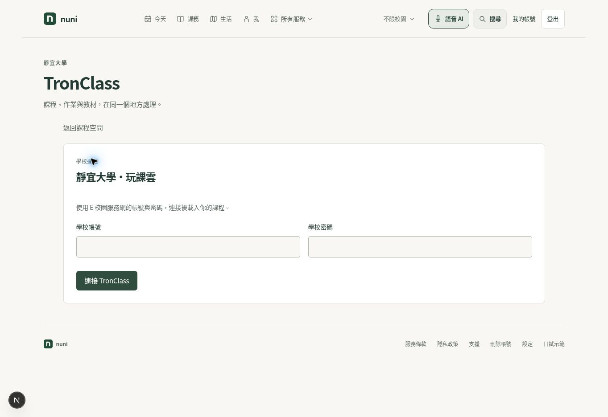

# TronClass 完整 Web 綁定驗證環境（2026-11-18）

這次新增可重現的完整 Next.js、Firebase Auth Emulator 與 Firestore Emulator 環境，供使用正常登入與 TronClass 綁定表單驗證。它與僅攔截 API 的瀏覽器視覺測試分開；不載入正式 Firebase 憑證，也不匯入瀏覽器 Cookie。

## 啟動與使用

需要 repository 指定的 Node 22、pnpm 10、Java 21 與已安裝的 workspace dependencies。在沒有 `.env`、`.env.local` 或 development 環境檔的乾淨 checkout 執行：

```sh
TRONCLASS_VERIFY_RUNTIME=1 pnpm test-env:tronclass
```

開啟 launcher 印出的完整 Web 登入 URL，按「使用本機測試學生甲」。這個入口只在 development、明確啟用的 demo Firebase emulator 中出現，使用 repository 既有的公開 seed 帳號，經過真正的 Firebase email/password 登入及伺服器 ID token 驗證。正式版不提供此入口。

真人校方帳號綁定僅限本機單人使用。登入後前往 `/tronclass`，在正常綁定表單輸入本人的學校帳密。公開測試學生的 UID 是共用的，多人若進入同一套環境，就可能存取該 UID 已保存的校方 session。啟用真人綁定的本機服務請勿透過轉發、隧道或反向代理分享。測試學生帳號只提供本機 nuni 身分；不代表已登入學校，不授予其他帳號的課程權限。不要把校方密碼、Cookie、簽章 URL、HAR 或私人作業存入 Git 或測試 fixture。

Next 與 Firebase emulators 固定監聽 `127.0.0.1`。若 `TEST_HOST` 或 `HOST` 指定了 `127.0.0.1`、`localhost` 以外的位址，或偵測到 CI 或 managed preview 標記，launcher 會關閉 TronClass 整合，只能使用合成 fixture。

在 managed preview 中，由既有 preview daemon 設定 `TRONCLASS_MANAGED_PREVIEW=1` 並提供 `PORT`。Auth、Firestore 與 Next 必須在同一個 preview 程序環境。瀏覽器使用 CLI 回傳的原始 URL。需要 TronClass API 的 `TRONCLASS_VERIFY_RUNTIME=1` 驗證只在本機整合啟用時執行。

## 已驗證的範圍

`scripts/test-env/verify-tronclass.cjs` 會直接呼叫真正的 Next routes、Auth Emulator 與 Firestore Emulator，沒有 mocked fetch，也不連線學校。它檢查：

- 正確的公開測試帳密可取得 Auth Emulator 核發的 token。
- 錯誤密碼、缺少 token、偽造 token 與停用帳號均被拒絕。
- `/api/tronclass` 仍執行正常的 token 驗證。
- 未連接狀態的 revision 經 API 寫入 Firestore 後，可由下一次請求讀回。
- 第二個測試帳號無法讀到第一個帳號的 binding revision。

驗證只修改隔離 emulator 中尚未綁定的公開 fixture；發現已連接的學校帳號時會停止，避免覆蓋該綁定。結果寫入 launcher 所列工作目錄的 `acceptance.json`，只包含時間、demo project ID 與布林檢查結果，不記錄 token、密碼或學校資料。

2026-11-18 的執行已通過上述 HTTP 與資料庫驗證。瀏覽器也已點擊公開測試學生入口，經過真正登入後到達 `/tronclass`，畫面顯示「我的帳號」、「登出」及正常校方綁定表單；學校帳密欄位仍為空白。這不是使用真人學校帳號完成綁定、附件上傳或正式繳交的證據。



## 隔離界線

伺服器只在 development/test、`demo-` 專案及兩個不同的 `127.0.0.1` emulator 位址都有效時建立專用 Admin app；production、非 demo 專案、缺少任一 emulator、遠端 host 或衝突專案均不接受。測試初始化不解析正式 service account，也不共用正式 Admin app。

同源 rewrite 僅提供 Auth SDK 的密碼登入、帳號查詢、token refresh，以及 Firestore SDK 通道；不提供 Auth 管理 API。production 不安裝這些 rewrites。launcher 禁用正式平台登入、legacy backend 與保留排程，並建立獨立的本機 session keys。學校 session 由既有 binding service 加密保存；停止環境時不自動 export Firestore。

啟動腳本先完整解析 `main()` 再執行長時間子程序，避免開發期間編輯腳本造成 Bash 後續讀取位置錯亂。修改 launcher、Next config 或環境設定後，應停止再重新啟動；不靠放寬瀏覽器或網路政策恢復測試。

## 尚未完成的真人驗收

目前尚缺正常綁定後的實際 metadata、binary upload、必要 callback、正式 submission acknowledgment 與本人精確讀回。既有完成檔案的 preview metadata 沒有新上傳 URL，下載網域規則也不能推導成上傳授權。

production 的 `contractVerified` 仍為 `false`，單獨設定 write environment flag 不能開放正式送交。補交／重繳／草稿狀態讀取亦不會自動授予寫入權限；見 [繳交時段與版本語意](./tronclass-submission-windows-2026-11-18.md)。

## 編譯版 UI 回歸的診斷

`scripts/tronclass/check-browser.py` 仍使用完全合成資料，並封鎖所有外部請求。它在草稿恢復失敗時，額外保存當下可見文字與截圖、目前 scenario 的操作清單、平台 session 請求時序、頁面可見性／pageshow 事件與 console errors。這些資料用來區分父層重新掛載、fresh prepare 失敗及實際草稿遺失；不把合成 UI 通過當成真實學校收件。
