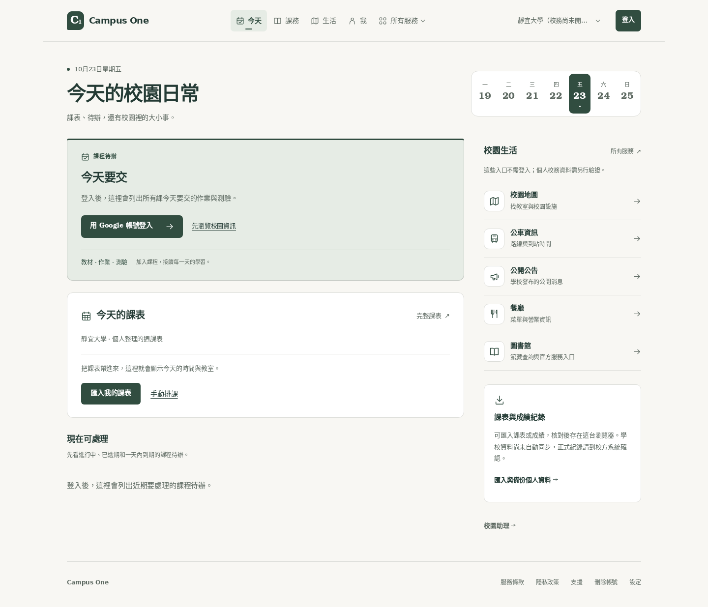
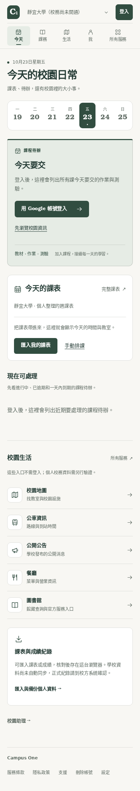
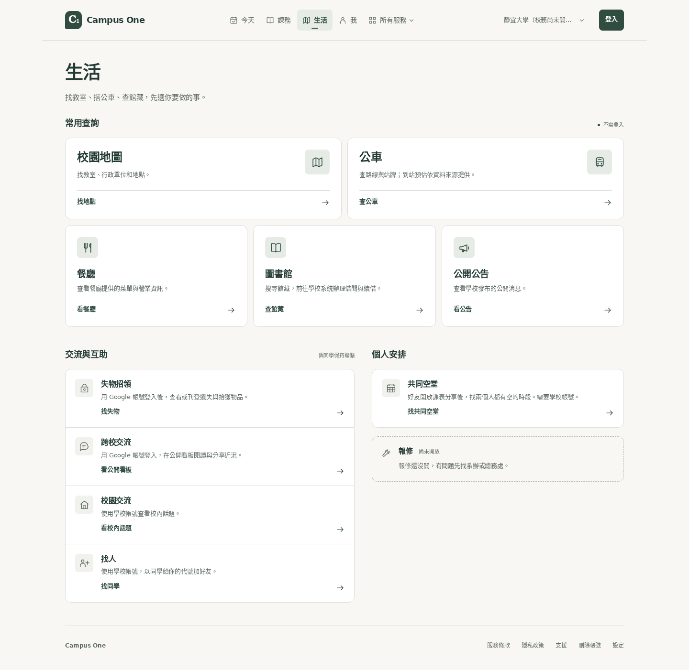
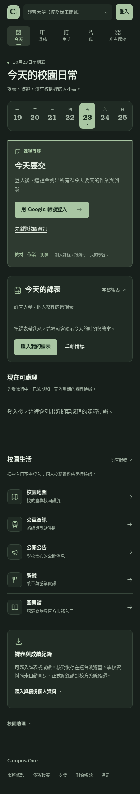

# Campus One 介面檢視

## 畫面

以下截圖來自本機 production build 的訪客情境。學校目錄使用測試資料；課程與帳號資料未連接正式服務。手機截圖是響應式 Web，原生 App 的修改另以型別檢查與既有測試驗證。

### 首頁・桌面 1440 px



### 首頁・手機 390 px



### 生活服務・桌面 1440 px



### 首頁・深色模式 390 px



## 檢查範圍

- 首頁與生活頁：1440、768、390、320 px，沒有橫向溢出。
- 服務選單：展開、Escape 關閉與焦點返回。
- 校園切換：選擇後收合，主要導覽保留所選校園。
- 深色模式、320 px 大字模式及減少動態設定。
- 課表：鍵盤操作、原生拖曳、取消、儲存及重新載入。
- 校園隔離：靜宜、清華、不限校園之間切換，不混用個人課表。

## 重現

沿用 `.github/workflows/timetable-browser.yml` 的安裝與本機 production server 步驟，再依序執行：

```sh
python scripts/timetable-browser-smoke.py
python scripts/campus-visual-smoke.py
```

兩個腳本只接受 localhost 或 127.0.0.1。視覺檢查會把當次截圖與結果寫入 `artifacts/campus-visual/`，不使用登入中的使用者工作階段。
