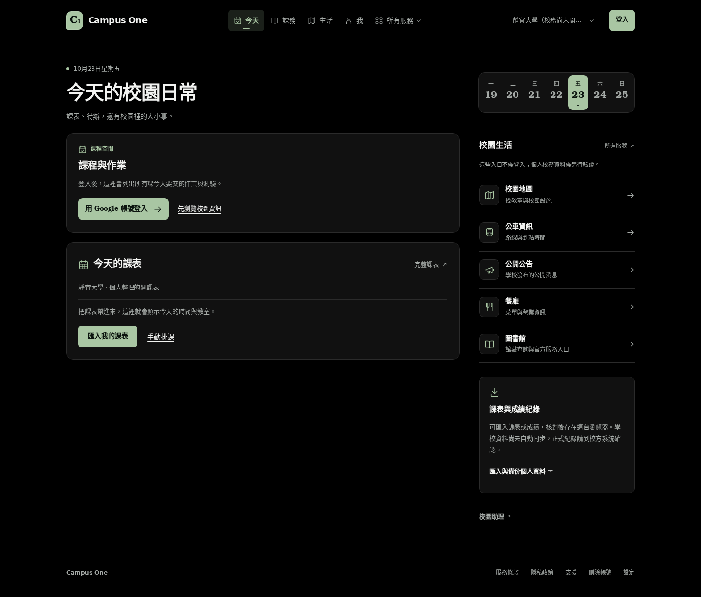
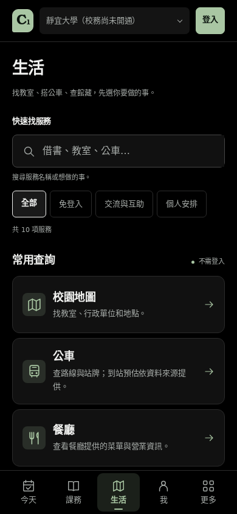
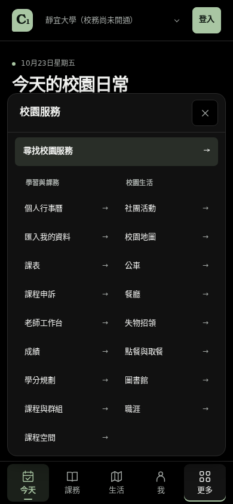

# Campus One 介面檢視

## OLED 與操作改善

深色模式使用 `#000000` 頁面底色，卡片、浮起面板與互動狀態採 `#111111`、`#191919`、`#232323`。文字與邊界使用中性色階，品牌綠保留在選取狀態及主要操作。

手機主要導覽固定於底部，包含安全區留白；服務選單向上展開，保留可捲動內容及固定關閉按鈕。生活服務可依名稱、需求及分類查找，清除與空結果可以直接恢復。首頁縮短訪客登入提示，保留課表與公開服務入口。

以下截圖來自本機 production build 的訪客情境。學校目錄使用測試資料，沒有連接正式課程或帳號資料。手機圖為 390 × 844 的響應式 Web 實際視窗；原生 App 另以型別與既有流程測試驗證。

### OLED 桌面首頁



### OLED 手機首頁


### 服務搜尋與分類



### 手機服務選單



### 淺色模式

- [桌面首頁](home-desktop.png)
- [手機首頁](home-mobile.png)
- [桌面生活服務](life-desktop.png)

## 已檢查範圍

- 首頁與生活頁：1440、768、390、320 px，沒有橫向溢出。
- 手機底部導覽與頁尾操作不互相遮擋。
- 選單展開、關閉、Escape 與焦點返回；校園切換後保留導覽範圍。
- 服務搜尋、空結果恢復、分類及尚未開放的報修狀態。
- 系統深色、手動深色、淺色、大字與減少動態設定。
- 頁面及瀏覽器主題色為純黑；公車與離線頁維持深色偏好。
- 課表鍵盤操作、原生拖曳、取消、儲存及重新載入。
- 靜宜、清華、不限校園之間切換，不混用個人課表。

## 重現

沿用 `.github/workflows/timetable-browser.yml` 的安裝與本機 production server 步驟，再依序執行：

```sh
python scripts/timetable-browser-smoke.py
python scripts/campus-visual-smoke.py
```

兩個腳本只接受 localhost 或 127.0.0.1。視覺腳本保存當次截圖與結果到 `artifacts/campus-visual/`，不使用登入中的使用者工作階段。
