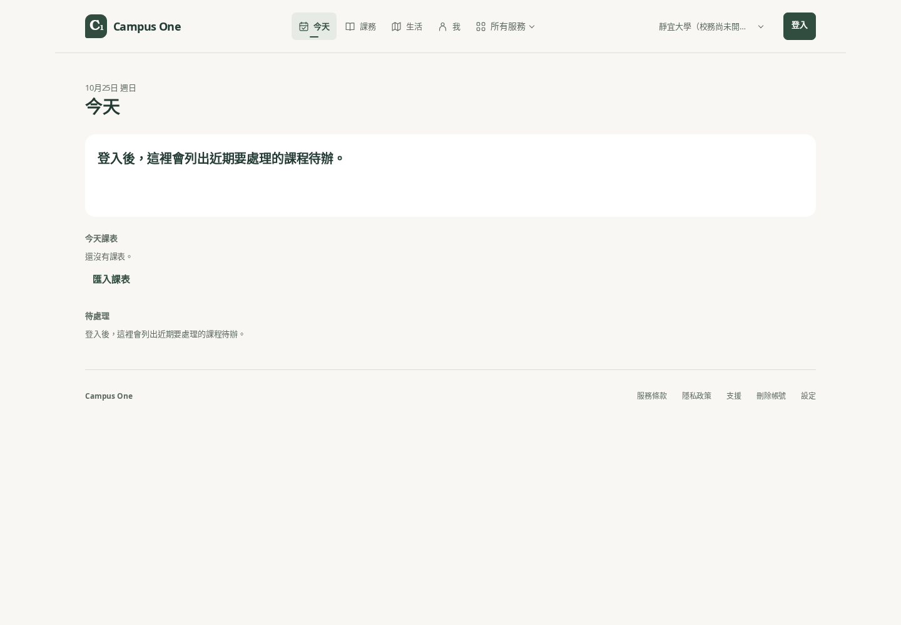
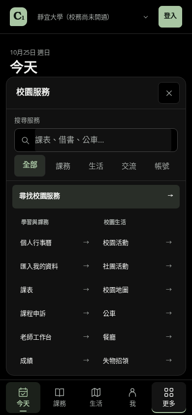
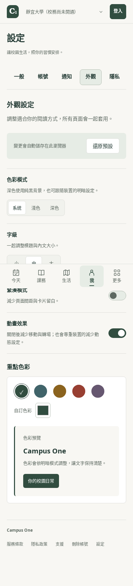

# Campus One 體驗整合驗收｜2026-10-25

本次整合既有功能分支，補齊 Web 與 App 的入口、操作流程與跨校資料隔離，並完成本機測試及 production build 的瀏覽器驗收。此紀錄不代表正式站、商店 App 或所有後端功能已發布。

## 來源與範圍

整合基底：`main` 的 `6abe69be1520176e4714fe709b85360ad65e5a0c`。下列四個 PR 以 merge commit 保留原始歷史，再加入本次體驗修正。

| PR | 原始 head | 整合內容 |
| --- | --- | --- |
| [#165](https://github.com/Miiduoa/graduation/pull/165) | `8d8b79b63da5111b5ae8244ea23a4774e247ad23` | 依學校提供課務來源、助理與校園服務入口 |
| [#170](https://github.com/Miiduoa/graduation/pull/170) | `99b02bd1f545c4b754bd24c254bb9c2066c3f982` | 跨校資訊、活動報名及個人行程提醒 |
| [#172](https://github.com/Miiduoa/graduation/pull/172) | `e6a95343e377b5b2ae2cf71cc92a29d60f447bae` | 失物招領跨端恢復、教材查找及學分試算 |
| [#169](https://github.com/Miiduoa/graduation/pull/169) | `45bdf1ae502eb1a6604a55c26947a879688e4932` | 校方權責、平台監督及 Web／App 管理工作區 |

## 完成的操作改善

- **Web 導覽與設定**：主要導覽、服務選單與校園切換保留目前學校；選單支援搜尋、鍵盤操作、空結果恢復及關閉後焦點返回。設定分區支援深層連結、頁面片段及瀏覽器上一頁／下一頁。行動底部導覽不遮住最後一個操作。
- **今天頁與個人資料**：沒有截止日期的待辦仍可見；更多待辦入口保留課程脈絡；相同 ID 的內容更新會刷新主要提示。帳號或學校切換時，個人紀錄與手動課表依所屬範圍更新，避免顯示上一個範圍的內容。長標題、大字體及 OLED 深色模式一併驗證。
- **App 搜尋與課程入口**：全域搜尋提供明確的服務入口、結果與空狀態，導航對應實際註冊畫面；課程查詢使用正確學期，不再沿用過期固定值。跨校官方服務保留所選學校。
- **課表、活動與提醒**：課表可用拖曳及鍵盤移動，支援取消、儲存、重載與今天空堂操作；未確認節次的學校不借用其他學校時刻。活動搜尋期間仍可載入下一頁；個人行程提醒保留排程、取消及恢復的一致性。
- **失物、教材與學分**：失物招領補齊草稿與跨端恢復；教材查找涵蓋後續資料頁；學分試算依有效成績及學校規則計算，並呈現資料不足狀態。
- **管理工作區**：區分平台管理、學校管理與服務人員權責。保留 CSV 公式防護、匯出範圍標記及分頁操作紀錄匯出；帳號、學校或角色改變時，舊匯出操作立即失效，暫存檔會清除。管理員降級後不能沿用舊選單匯出私密紀錄。

## 驗證結果

下表是不同範圍、不同輪次的實際結果；部分測試重疊，**不加總成單一測試數**。Web 全量測試完成後另有最後一輪課表調整，已補跑相關 28 項測試、production build、Web typecheck 及完整瀏覽器檢查。

| 範圍 | 結果 |
| --- | --- |
| Web 全量 | 264 個檔案通過、4 個略過；2,973 項通過、11 項略過；exit 0 |
| 最後一輪課表相關測試 | 28 項通過 |
| Web production build | 完成，建置檢查通過 |
| App 整合測試 | 36 suites／542 項通過 |
| App 最終導覽相關測試 | 7 suites／148 項通過；與整合測試重疊 |
| App 管理及授權 | 管理 14 suites／68 項、身分權限 29 項通過；與整合測試重疊 |
| Functions | 管理及授權 207 項、助理 75 項通過 |
| Firestore／Storage emulator | Node 174 項及 Web emulator 10 項通過；0 失敗、0 略過 |
| Typecheck | shared、mobile、Web 全部通過 |
| Lint | 0 errors；仍有既有 warnings |
| 最終本機瀏覽器 | 視覺與操作 18／18、課表 8／8，共 26 項通過；兩組 exit 0 |

瀏覽器使用本機 production build、訪客狀態及明確的測試資料；檢查 1440、768、390、320 px 版面、200% 文字縮放、OLED 外觀、選單鍵盤操作、設定連結及課表學校隔離。這些結果不包含原生實機、真實學校帳號或正式環境部署驗收。

## 畫面與可核對證據

共保留五張 PNG，以及[視覺／操作結果](campus-experience-20261025/results.json)與[課表結果](campus-experience-20261025/timetable-results.json)。以下畫面皆為訪客與本機資料，沒有使用正式學生帳號。

桌面首頁：今天頁、主要導覽與服務入口。



手機服務頁：OLED 深色模式與可操作的服務分類。



手機設定頁：分區導覽與設定項目。



其餘畫面：[手機 OLED 首頁](campus-experience-20261025/home-oled-mobile.png)、[手機服務搜尋](campus-experience-20261025/service-search-mobile.png)。

## 重跑入口與發布界線

使用 Node 22、pnpm 10；emulator 另需 Java 21。從 repository 根目錄可重跑核心檢查；完整測試範圍以最終 PR CI 為準。

```sh
pnpm typecheck
pnpm lint
pnpm --filter web test
pnpm --filter web build
pnpm --filter mobile test --ci
pnpm --filter functions test --runInBand
pnpm test:rules
```

瀏覽器需先依 [Timetable Browser workflow](../../.github/workflows/timetable-browser.yml) 準備 standalone 的 static／public 資產，再啟動本機伺服器；以下瀏覽器指令在另一個終端執行，須已安裝 Playwright Chromium。

```sh
HOSTNAME=127.0.0.1 PORT=3100 node apps/web/.next/standalone/apps/web/server.js

TIMETABLE_TEST_URL=http://127.0.0.1:3100 python scripts/timetable-browser-smoke.py
CAMPUS_VISUAL_URL=http://127.0.0.1:3100 python scripts/campus-visual-smoke.py
```

兩個瀏覽器腳本均限制 loopback 目標。本機 emulator 若受 HTTP proxy 影響，僅在該測試程序移除 HTTP(S) proxy；本次沒有修改正式網路或服務設定。

一般 PR／push 的 GitHub CI 不會部署 Web、App 或 Firebase。正式發布需另行使用既有發布流程，並核對實際來源 SHA、服務狀態及發布結果；本驗收不宣稱已上線。
