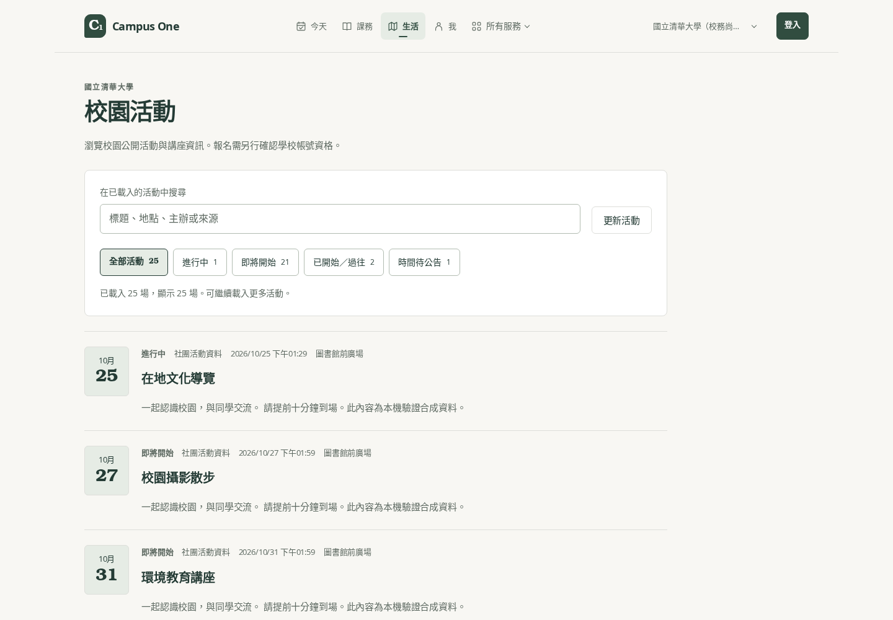

# 校園公告、活動與生活服務流程驗證

日期：2026-10-25

本次延續 Campus One 改版，處理公告、活動、失物招領、圖書館與 App 交通查詢的操作斷點。基底已整合 `main` 的 `61eaac26`（含同日 LMS 工作區改版）；沒有修改 LMS 的產品流程。

## 使用者可以直接感受到的改變

| 範圍 | 修正前的問題 | 本次行為 |
| --- | --- | --- |
| 公告閱讀 | 正文在正規化時被摘要覆蓋；只找標題容易漏掉資訊 | 保留完整正文、段落及摘要；搜尋包含正文 |
| 公告列表 | 返回列表或重新整理後，搜尋與展開狀態可能丟失 | 搜尋、分類、學生／全部公告、置頂篩選與展開頁數寫入網址並正確還原 |
| 活動列表 | 時間判斷混淆；搜尋無結果後無法順暢找到後頁活動 | 區分進行中、即將開始、已開始／過往及時間待公告；無結果時仍可載入下一頁 |
| 活動詳情 | 缺少可操作的行事曆匯出 | 下載實際 `.ics` 檔；缺少開始時間時停用，缺少結束時間時不自行補時長 |
| 失物招領 | 開啟物品、刊登或取消後，難以回到原本清單 | 保存搜尋、遺失／拾獲、處理狀態、我的刊登及展開頁數 |
| 圖書館 | 按 Enter 沒有送出；正式 CSP 擋住館藏表單 | 已確認格式的館藏查詢使用原生 GET 表單；Enter 與按鈕一致，保留學校及欄位參數 |
| App 交通 | 定位尚未完成時，舊回應可能覆蓋較新的站名查詢 | 最後操作優先；定位可取消，十秒逾時後恢復可操作狀態 |
| 窄螢幕與大字 | 篩選文字被擠成一字一行；活動日期裝飾欄壓縮標題 | 篩選按鈕保持水平文字並整顆換行；手機活動內容使用完整閱讀寬度 |

App 的公告與活動同步加入搜尋、時間篩選、分段展開、結果數量及清除篩選，並處理鍵盤開啟時的點擊、長標題與校園／帳號切換。

## 資料、導覽與錯誤狀態

- 公告同步會移除標題中的教師後綴，但保留 `audience`、`studentFeed` 等資料。本次修正前端與 Functions 再分類時忽略這些 metadata 的問題：教師公告留在全部公告，不再被錯放回學生公告。沒有 metadata 的舊資料維持既有判斷。
- `visible: false` 的公告不顯示於列表或直接網址；canonical 紀錄已隱藏時，不回退顯示同 ID 的舊集合紀錄。這是顯示邏輯修正，未擴張資料授權。
- 列表使用實際瀏覽器網址作為狀態來源，處理 Next 返回快取頁時的舊 `searchParams`。只更新自己擁有的 query 欄位，保留校園、其他參數與 fragment。
- 切換校園不沿用另一校結果；帳號改變不顯示上一個帳號的個人篩選。初次登入狀態解析則保留使用者開啟的有效網址情境。
- 活動更新保留已載入深度與原內容，失敗可重試；同一次操作不會重複發出相同游標請求。深連結最多接受 100 頁，分批還原，每批最多十頁，後續提供明確的繼續還原按鈕。
- 公告與活動顯示的數量限定於已載入資料，沒有把部分來源計算包裝成全校總數。
- 服務返回網址由固定路徑與允許欄位重建。登入返回保留有效服務篩選與最多 200 字搜尋，其他目的地維持既有長度限制；同 origin、路徑清理、credential 拒絕、PKCE／nonce／transaction 契約保留。
- 行事曆使用穩定的學校／來源／活動識別、UTC 時間、TEXT escaping 與 UTF-8 folding。分享／匯出連結不含列表搜尋；不自動加入提醒、參與者、報名或訂閱。共用序列化抽出後，既有個人行事曆十組樣本輸出逐位元組一致。
- 館藏表單只允許目錄中已確認的 14 個 HTTPS origin，沒有放寬成 wildcard。未知查詢格式維持官方館藏入口與複製關鍵字的交接方式。

## 自動化驗證

| 檢查 | 結果 |
| --- | --- |
| 完整 Web 測試與 coverage | 整合 `61eaac26` 後，276 套通過／4 套略過；3,337 項通過／11 項略過，0 失敗。Statements 77.14%、branches 73.12%、functions 78%、lines 80.12% |
| Web 公告、失物與共用網址回歸 | 8 套、126 項通過；最後初次登入狀態修正的公告頁 55 項通過，為重跑子集合 |
| 活動與共用日曆、登入返回回歸 | 12 套、237 項通過；頁數還原測試的非同步等待已改為明確 flush，不增加 timeout |
| App 公告、活動與公共內容整合 | 5 套、104 項通過；最後正文提示修正的畫面套件 53 項通過，為重跑子集合 |
| App 交通查詢 | 2 套、23 項通過；新增請求競爭回歸在修正前失敗 |
| Web 圖書館與 CSP 相關回歸 | 6 套、44 項通過；五個 CSP 回歸在原設定失敗 |
| Functions 公告同步／分類 | 7 套、53 項通過；新增 metadata 回歸在修正前失敗 |
| 型別與靜態檢查 | Web、Mobile、shared typecheck 通過；修改檔 scoped ESLint 無 error；shared 全域 lint 的三個既有 warning 未停用 |
| Web 正式建置 | 含最終公告／活動窄螢幕修正的 `next build` 成功，未略過型別檢查 |
| 差異格式 | `git diff --check` 通過 |

表中套件有交集，不應將各列案例數相加。Mobile 聚焦回歸與本機正式建置完成於 `32989e6a` 基底加本輪變更；之後主線 `61eaac26` 的 LMS 合併未修改這些服務來源，完整 Web 測試已在整合後重跑。GitHub PR 的檢查另以實際提交版本執行。

完整 Web 測試前已停止同時執行的瀏覽器工作，避免競爭造成非同步測試逾時。先前受影響的 MapClient 與 EventList 兩套共 48 項已獨立重跑通過，沒有放寬 timeout。

## 真實 production build 的瀏覽器驗證

使用正式 Next 建置、本機 Firebase Auth／Firestore emulator、專案既有 Firestore 規則與正常 CSP。資料限定於 `demo-campus-services` 合成專案；外部網路要求由驗證工具攔截，沒有寫入正式資料或寄出通知。

| 流程 | 情境數 | 代表操作與結果 |
| --- | ---: | --- |
| 公告 | 11 | 30→60 則展開、正文搜尋、Back／返回／reload 保留狀態、官方公告、隱藏紀錄、換校、320／390px 明暗模式及 200% 文字 |
| 活動 | 10 | 時間分組、第二頁搜尋、返回與更新保留頁數、清除焦點、真正下載 `.ics`、缺漏時間、換校、320／390px 與大字排版 |
| 圖書館 | 8 | 清華、彰師、靜宜按 Enter 送出正確 GET，保留 `&`；長庚未知格式交接；換校清空；popup 無 opener；沒有 CSP 違規 |
| 登入後失物招領 | 8 | 真正 emulator 登入與既有規則、50→64 筆展開、第二頁返回、四種篩選、重新整理、空結果重設、換校與明暗模式 |
| 合計 | **37** | **0 pageErrors**；失物招領 0 networkErrors，圖書館 0 CSP violations |

失物招領使用正常 Firebase SDK 取得本機匿名帳號，驗證登入後的實際資料讀取與導覽；沒有在產品新增測試入口、授權例外或假登入邏輯。瀏覽器導航取消的請求另外計數，不當成讀取錯誤。

另以實際 React Native 畫面元件建立隔離 RN Web 預覽，完成 **11 項操作與排版檢查，0 pageErrors**。這組結果與上表 37 項分開計算；200% 文字為瀏覽器模擬，不代表 iOS／Android 實機的字型縮放驗證。

機器可讀結果：[公告](campus-service-flows-20261025/announcements-results.json)、[活動](campus-service-flows-20261025/events-results.json)、[圖書館](campus-service-flows-20261025/library-results.json)、[失物招領](campus-service-flows-20261025/lost-found-results.json)、[App 元件預覽](campus-service-flows-20261025/app-preview-results.json)。

## 畫面證據

截圖均使用本機合成資料。校園名稱旁的服務狀態也屬 fixture，不是對正式學校整合現況的聲明。長頁截圖中的固定導覽列會留在截圖時的 viewport 底部。

### 活動桌面與手機



[390px 亮色活動](campus-service-flows-20261025/events-mobile-light.png) · [320px OLED、200% 文字](campus-service-flows-20261025/events-320-large.png)

### 公告閱讀與篩選

[390px 亮色](campus-service-flows-20261025/announcements-mobile-light.png) · [390px OLED](campus-service-flows-20261025/announcements-mobile-oled.png) · [320px、200% 正文](campus-service-flows-20261025/announcement-reading-320-large.png)

### 生活服務與 App

[圖書館](campus-service-flows-20261025/library-mobile-light.png) · [失物招領](campus-service-flows-20261025/lost-found-mobile-oled.png) · [App 活動元件](campus-service-flows-20261025/app-events-mobile-light.png) · [App 公告大字](campus-service-flows-20261025/app-announcements-320-large.png)

## 重現方式與驗證邊界

使用專案既有 Node 22 與 pnpm 10 鎖檔：

```sh
pnpm install --frozen-lockfile
pnpm --filter web exec vitest run --coverage
pnpm --filter mobile test --ci
pnpm typecheck
pnpm --filter web build
git diff --check
```

本機瀏覽器工具位於 `scripts/announcement-browser-smoke.py`、`scripts/event-browser-smoke.py`、`scripts/library-browser-smoke.py`、`scripts/lost-found-browser-smoke.py`。先以 `demo-campus-services` 啟動 Firestore 8085 與 Auth 9099，使用 `scripts/seed-service-browser-fixtures.py` 填入合成資料，再啟動啟用 emulator 設定的正式建置於 3105。工具只接受 localhost／127.0.0.1，可透過 `CAMPUS_SERVICE_URL` 與 `CAMPUS_SERVICE_CHROMIUM` 指定本機服務及 Chromium。

本次證據不包含真實學校 SSO、正式校務資料、各校館藏服務的外部可用性或 iOS／Android 實機驗證。沒有新增依賴、資料庫遷移或正式環境設定；正式部署未在本輪執行。
