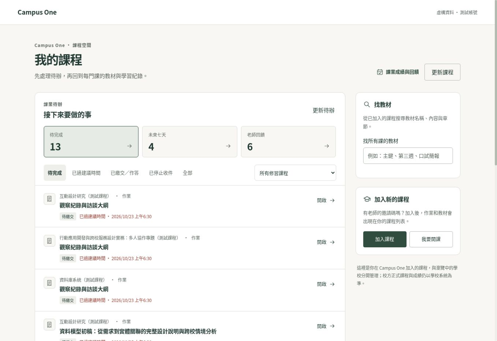
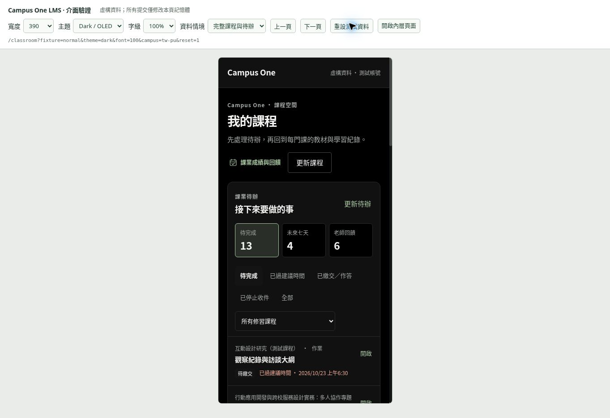
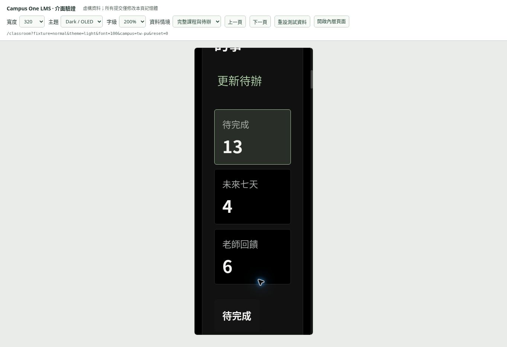

# LMS 學習工作區改版驗證

日期：2026-10-25

基底：`main`，`5d1a946b1e03c816cc33690db7d5aec2ae98836c`。本次改版使用獨立分支，保留同日的帳號導覽與頁尾修改。

## 改版範圍

- Web「我的課程」改為先顯示跨課程待辦，再提供課程目錄、教材搜尋與加入／開課操作。
- 待辦支援課程、待完成、未來七天、老師回饋、已繳交及停止收件等篩選；作業與測驗可直接開到指定項目。
- 課程內的學習路徑、教材、作業與測驗以網址保留分頁；返回課程目錄保留搜尋、角色、待辦及學校導覽情境。
- 作業與測驗加入搜尋、待完成優先排序。切換分頁或篩選時保留已掛載的輸入表單，避免丟失尚未送出的內容。
- Mobile 同步採用跨課程待辦與回饋來源，加入課程搜尋、角色／封存篩選、活動搜尋及長清單收合。
- 沿用既有色彩、字級與 OLED 主題；窄螢幕及放大文字下，摘要依可用空間換列。教材文案移除欄位、API、游標等實作說明。

## 資料與權限規則

- 只有進行中的修課學生課程納入待辦；平台課程為帳號範圍，不以瀏覽中的學校假造課程歸屬或校方同步。
- 狀態依伺服器的繳交／作答紀錄判斷。建議完成時間與停止收件分開處理，超過建議時間仍可能開放繳交。
- 重交後，早於最新提交的老師回饋不列為本次提交的新回饋。
- Shared loader 每次最多讀取三門課；一般單一來源失敗保留已成功內容，403／404 移除整門課待辦，401 或工作階段變更中止讀取。
- 帳號或課程成員關係改變時，不顯示舊範圍的待辦／教材搜尋結果。Mobile 清單被拒絕後，再次重試等待期間也不恢復舊資料。
- 達來源筆數上限時，數量與回饋空狀態明確限定於已載入範圍；部分失敗不呈現為完整的零待辦。

## 自動驗證

| 項目 | 結果 |
| --- | --- |
| Web LMS 與相關 shared 邏輯 | 16 套、255 個不同案例完成驗證，包含 shared agenda 19 案例 |
| Web 首輪等待失敗後重跑 | 首輪 252 通過、3 個等待／逾時失敗；受影響 3 套重跑 90 個全部通過，沒有放寬 timeout |
| 最後教材文案修改 | 4 套、76 個全部通過，為上述 255 個中的子集合 |
| Mobile LMS 最終整合 | 3 套、97 個全部通過 |
| 型別檢查 | Web、Mobile、shared 通過；Web 最後正式建置亦包含型別檢查 |
| Web 正式建置 | 最終整合版 `next build` 成功，包含主分支最新修改，未略過型別檢查 |
| ESLint | 相關修改檔無 error；Web 既有與衍生狀態 effect 的 warning 未停用規則 |
| 差異格式 | `git diff --check` 通過 |

主要重現指令（Node 22、既有鎖檔）：

```sh
pnpm --filter web exec vitest run src/features/nuni src/lib/nuniStudyAgenda.test.ts src/lib/courseMaterials.test.ts src/lib/courseWorkLanding.test.ts --maxWorkers=1
pnpm --filter mobile exec jest --runInBand --runTestsByPath src/__tests__/NuniCourses.test.tsx src/__tests__/StudyAgenda.test.tsx src/__tests__/nuniActivityTasks.test.ts
pnpm --filter web typecheck
pnpm --filter mobile typecheck
pnpm --filter @campus/shared typecheck
pnpm --filter web build
git diff --check
```

首輪 Web 測試與正式建置／型別檢查同時執行時出現等待失敗，完成建置後獨立重跑受影響套件皆通過。重跑案例數不重複計入總數。

## 瀏覽器驗證

以真實修改後的 React 元件與樣式建立隔離預覽；只替換登入、導覽、頁面外框及資料來源邊界。所有課程、姓名與提交內容皆為虛構資料，提交只變更預覽記憶體，沒有讀寫正式課程。

已操作及確認：

- 桌面寬度、768px、390px 與 320px，亮色／OLED 主題，以及 200% 根字級。
- 390px、320px／200% 與 768px／200% 的內容沒有頁面橫向溢出；320px 放大字級的摘要由固定三欄改為自動換列。
- 課程搜尋與角色篩選，以及指定單一課程的待辦篩選。
- 從待辦進入指定作業，切換教材後返回作業，原輸入仍存在。
- 測試作業送出後出現繳交時間與內容；返回首頁時保留搜尋與課程篩選，待辦數由 3 更新為 2。
- 尚未加入課程提供邀請碼入口；讀取失敗提供重試；部分來源失敗保留成功項目並標示數量不完整。

### 桌面首頁



### 390px OLED



### 320px、200% 字級



## 驗證邊界

這份紀錄不是正式環境登入測試，也不代表已部署。瀏覽器操作驗證採隔離資料；沒有驗證真實學校系統、正式檔案上傳或發佈。Mobile 已完成元件／服務測試與型別檢查，尚未在 iOS／Android 實機或模擬器驗證。截圖中的上方測試標記與外層控制列僅屬預覽，未加入產品。

本次沒有新增依賴、資料庫遷移、驗證例外或正式環境設定。
